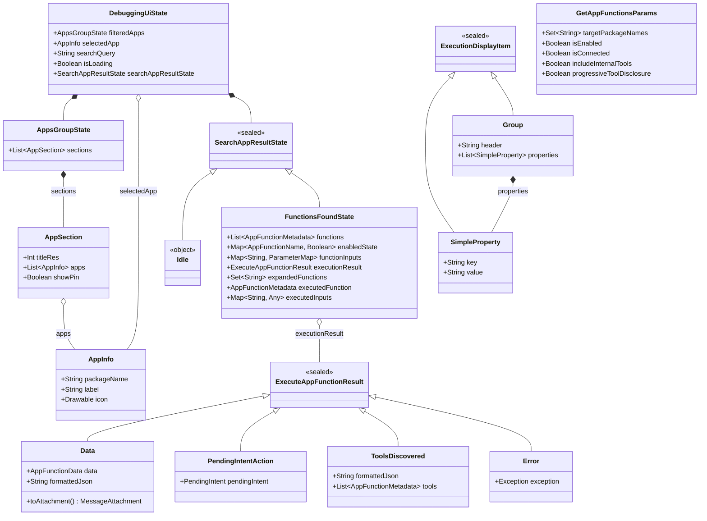
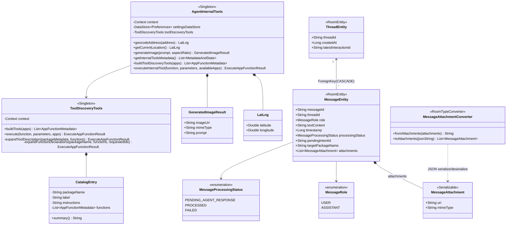
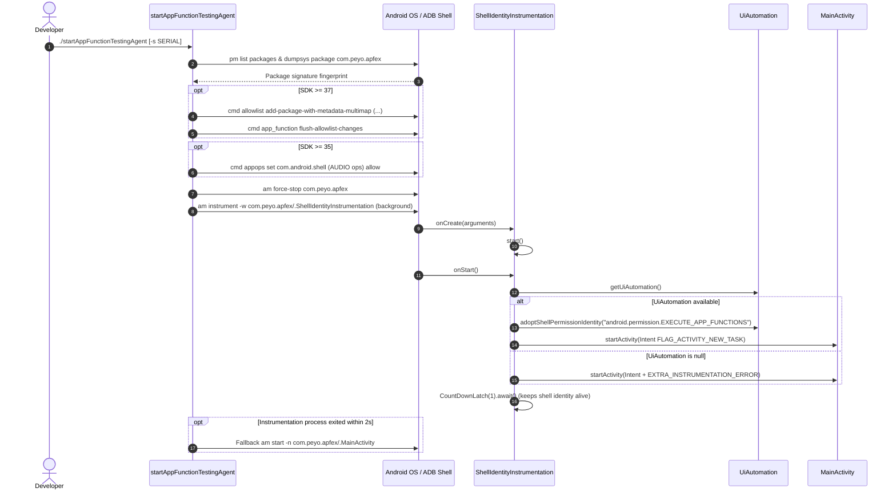
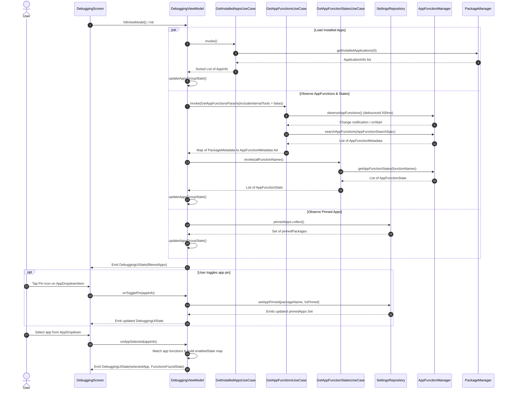
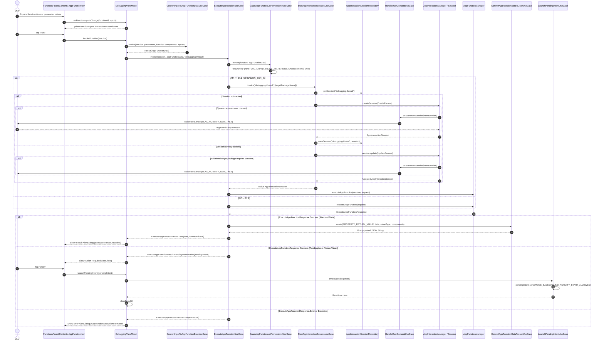
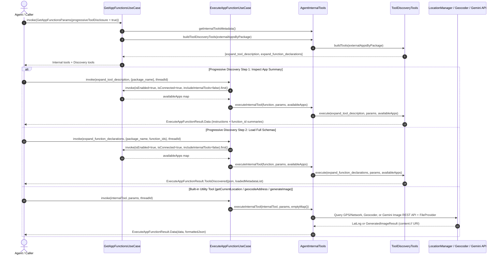

# AppFuncEx (`com.peyo.apfex`) — UML Class & Sequence Diagrams

This document describes the architecture, static structure (UML Class Diagrams), and runtime behavior (UML Sequence Diagrams) of **AppFuncEx**, an Android Jetpack Compose + Hilt application for discovering, inspecting, and executing Android **AppFunctions** (`androidx.appfunctions`) and managing `AppInteractionSession` flows.

---

## 1. Architecture Overview

The application follows **Clean Architecture + MVVM** organized into four primary layers:

| Layer | Package(s) | Responsibilities |
| :--- | :--- | :--- |
| **Entry & DI** | `com.peyo.apfex`, `com.peyo.apfex.di` | Application bootstrap (`AppFunctionsApplication`), Activity host (`MainActivity`), privileged shell permission adoption (`ShellIdentityInstrumentation`), and Hilt bindings (`AppFunctionModule`, `DataModule`). |
| **UI (Presentation)** | `com.peyo.apfex.ui.screens.debugging`, `com.peyo.apfex.ui.theme` | Unidirectional data flow via `DebuggingViewModel` + `DebuggingUiState`, searchable/pinnable app dropdown, dynamic recursive parameter editors (`AppFunctionDataTypeInput`), and JSON/error/PendingIntent result dialogs (`FunctionsFoundContent`). |
| **Domain** | `com.peyo.apfex.domain.appfunction`, `com.peyo.apfex.domain.appinteraction`, `com.peyo.apfex.domain.pendingintent` | Stateless/reusable use cases for discovering installed apps and AppFunctions, checking enabled states, converting raw UI/LLM inputs into `AppFunctionData`, granting `content://` URI permissions, managing API 37.2 `AppInteractionSession`s + user consent, executing functions, formatting outputs/exceptions, and launching `PendingIntent`s. |
| **Data** | `com.peyo.apfex.data`, `com.peyo.apfex.data.db.entities` | Jetpack DataStore settings (`SettingsRepository`), thread-scoped in-memory `AppInteractionSession` cache (`AppInteractionSessionRepository`), built-in agent tools & progressive tool disclosure (`AgentInternalTools`, `ToolDiscoveryTools`), and Room persistence entities (`ThreadEntity`, `MessageEntity`). |

---

## 2. UML Class Diagrams

### 2.1 End-to-End Architecture Class Diagram

```mermaid
classDiagram
    direction TB

    namespace Entry_And_DI {
        class AppFunctionsApplication {
            <<HiltAndroidApp>>
        }

        class ShellIdentityInstrumentation {
            +onCreate(arguments)
            +onStart()
        }

        class MainActivity {
            <<AndroidEntryPoint>>
            +String EXTRA_INSTRUMENTATION_ERROR$
            +onCreate(savedInstanceState)
        }

        class AppFunctionModule {
            <<HiltModule>>
            +provideAppFunctionManager(context) AppFunctionManager
        }

        class DataModule {
            <<HiltModule>>
            +bindSettingsRepository(impl) SettingsRepository*
            +bindAppInteractionSessionRepository(impl) AppInteractionSessionRepository*
            +provideDataStore(context) DataStore~Preferences~
        }
    }

    namespace UI_Layer {
        class DebuggingScreen {
            <<Composable>>
            +DebuggingScreen(viewModel)
            +DebuggingScreenContent(uiState, callbacks)
            +AppDropdown(appGroups, searchQuery)
        }

        class FunctionsFoundContent {
            <<Composable>>
            +FunctionsFoundContent(state, callbacks)
            +AppFunctionErrorItem(function)
            -ExecutionResultDataView(formattedJson)
        }

        class AppFunctionItem {
            <<Composable>>
            +AppFunctionItem(function, isEnabled, expanded, inputValues)
            -ParameterInput(name, dataType, isRequired, value)
        }

        class AppFunctionDataTypeInput {
            <<Composable>>
            +AppFunctionDataTypeInput(dataType, value, onValueChange, components)
            +PrimitiveTextInput(value, onValueChange)
            +EnumDropdown(value, options)
            +BooleanTypeInput(value, onValueChange)
            +ObjectTypeInput(dataType, value)
            +ArrayTypeInput(dataType, value)
            +ComplexTypeInput(label, summary)
        }

        class DebuggingViewModel {
            <<HiltViewModel>>
            +StateFlow~DebuggingUiState~ uiState
            -List~AppInfo~ allInstalledApps
            -Set~String~ pinnedPackages
            -String DEBUG_THREAD_ID$
            +onAppSelected(appInfo)
            +onClearSelectedApp()
            +onSearchQueryChanged(query)
            +onFunctionInputsChange(functionId, inputs)
            +onFunctionExpandedChange(functionId, expanded)
            +invokeFunction(function)
            +clearResult()
            +launchPendingIntent(pendingIntent)
            +onTogglePin(appInfo)
        }

        class DebuggingUiState {
            +AppsGroupState filteredApps
            +AppInfo selectedApp
            +String searchQuery
            +Boolean isLoading
            +SearchAppResultState searchAppResultState
        }
    }

    namespace Domain_Layer {
        class GetInstalledAppsUseCase {
            +invoke() List~AppInfo~
        }

        class GetAppFunctionsUseCase {
            +invoke(params) Flow~AppFunctionsByPackage~
        }

        class GetAppFunctionStatesUseCase {
            +invoke(functionNames) List~AppFunctionState~
        }

        class ConvertInputToAppFunctionDataUseCase {
            +invoke(parameters, components, inputs) Result~AppFunctionData~
        }

        class ExecuteAppFunctionUseCase {
            +invoke(function, parameters, threadId) ExecuteAppFunctionResult
        }

        class GrantAppFunctionUriPermissionsUseCase {
            +invoke(function, parameters)
        }

        class ConvertAppFunctionDataToJsonUseCase {
            +invoke(name, data, dataType, components) String
        }

        class AppFunctionExceptionFormatter {
            <<object>>
            +format(exception, functionId) String
            +getAppFunctionException(throwable) AppFunctionException
        }

        class StartAppInteractionSessionUseCase {
            <<Singleton>>
            +invoke(threadId, targetPackages) AppInteractionSession
        }

        class HandleUserConsentUseCase {
            <<Singleton>>
            +invoke(intentSender)
        }

        class LaunchPendingIntentUseCase {
            +invoke(pendingIntent) Result~Unit~
        }
    }

    namespace Data_Layer {
        class SettingsRepository {
            <<interface>>
            +Flow~String~ geminiApiKey
            +Flow~Boolean~ progressiveToolDisclosure
            +Flow~StringSet~ pinnedApps
            +Flow~StringSet~ disconnectedApps
            +setGeminiApiKey(apiKey)
            +setProgressiveToolDisclosure(enabled)
            +setAppPinned(packageName, pinned)
            +setAppConnected(packageName, connected)
        }

        class DataStoreSettingsRepository {
            -DataStore~Preferences~ dataStore
        }

        class AppInteractionSessionRepository {
            <<interface>>
            +saveSession(threadId, session)
            +getSession(threadId) AppInteractionSession
            +invalidateSession(threadId)
        }

        class InMemoryAppInteractionSessionRepository {
            <<Singleton>>
            -ConcurrentHashMap sessionMap
            -ExecutorService executor
            -LifecycleListener lifecycleListener
        }

        class AgentInternalTools {
            <<Singleton>>
            +String INTERNAL_TOOL_PACKAGE$
            +String EXPAND_TOOL_DESCRIPTION$
            +String EXPAND_FUNCTION_DECLARATIONS$
            +geocodeAddress(address) LatLng
            +getCurrentLocation() LatLng
            +generateImage(prompt, aspectRatio) GeneratedImageResult
            +getInternalToolsMetadata() List~MetadataAndState~
            +buildToolDiscoveryTools(apps) List~AppFunctionMetadata~
            +executeInternalTool(function, parameters, availableApps) ExecuteAppFunctionResult
        }

        class ToolDiscoveryTools {
            <<Singleton>>
            +buildTools(apps) List~AppFunctionMetadata~
            +execute(function, parameters, apps) ExecuteAppFunctionResult
        }
    }

    %% Entry & UI relationships
    ShellIdentityInstrumentation ..> MainActivity : launches with shell identity
    MainActivity --> DebuggingScreen : hosts
    DebuggingScreen --> DebuggingViewModel : observes uiState & dispatches events
    DebuggingScreen --> FunctionsFoundContent : renders when FunctionsFoundState
    FunctionsFoundContent --> AppFunctionItem : renders per function
    FunctionsFoundContent ..> AppFunctionExceptionFormatter : formats errors
    AppFunctionItem --> AppFunctionDataTypeInput : renders per parameter
    AppFunctionDataTypeInput --> AppFunctionDataTypeInput : recurses for Object / Array / Ref
    DebuggingViewModel *-- DebuggingUiState : exposes StateFlow

    %% ViewModel to Domain/Data relationships
    DebuggingViewModel --> GetInstalledAppsUseCase : loads installed apps
    DebuggingViewModel --> GetAppFunctionsUseCase : observes AppFunctions
    DebuggingViewModel --> GetAppFunctionStatesUseCase : queries enabled states
    DebuggingViewModel --> ConvertInputToAppFunctionDataUseCase : builds AppFunctionData
    DebuggingViewModel --> ExecuteAppFunctionUseCase : executes function
    DebuggingViewModel --> LaunchPendingIntentUseCase : launches PendingIntent
    DebuggingViewModel --> SettingsRepository : observes/updates pinnedApps

    %% Domain internal relationships
    GetAppFunctionsUseCase --> GetAppFunctionStatesUseCase : filters by enabled state
    GetAppFunctionsUseCase --> SettingsRepository : filters disconnectedApps
    GetAppFunctionsUseCase --> AgentInternalTools : gets internal & discovery tools
    ExecuteAppFunctionUseCase --> GrantAppFunctionUriPermissionsUseCase : grants content URI read perms
    ExecuteAppFunctionUseCase --> ConvertAppFunctionDataToJsonUseCase : serializes return value
    ExecuteAppFunctionUseCase --> AgentInternalTools : routes internal tools
    ExecuteAppFunctionUseCase --> GetAppFunctionsUseCase : resolves connected apps for discovery
    ExecuteAppFunctionUseCase --> StartAppInteractionSessionUseCase : Lazy acquisition on API 37.2+
    StartAppInteractionSessionUseCase --> AppInteractionSessionRepository : caches session by threadId
    StartAppInteractionSessionUseCase --> HandleUserConsentUseCase : launches consent IntentSender

    %% Data & DI relationships
    DataStoreSettingsRepository ..|> SettingsRepository
    InMemoryAppInteractionSessionRepository ..|> AppInteractionSessionRepository
    AgentInternalTools --> ToolDiscoveryTools : delegates progressive disclosure
    DataModule ..> DataStoreSettingsRepository : binds
    DataModule ..> InMemoryAppInteractionSessionRepository : binds
```

---

### 2.2 Detailed UI State & Domain Model Class Diagram

---

### 2.3 Detailed Data, Internal Tools & Room Entities Class Diagram

---

## 3. UML Sequence Diagrams

### 3.1 Privileged App Launch & Shell Permission Adoption

Launching `AppFuncEx` via [`startAppFunctionTestingAgent`](file:///home/hdyoon/ex/apfex/startAppFunctionTestingAgent) configures device allowlists and starts [`ShellIdentityInstrumentation`](file:///home/hdyoon/ex/apfex/src/com/peyo/apfex/ShellIdentityInstrumentation.kt) so the process holds `android.permission.EXECUTE_APP_FUNCTIONS`.

---

### 3.2 App Discovery, Filtering & Selection Flow

When [`MainActivity`](file:///home/hdyoon/ex/apfex/src/com/peyo/apfex/MainActivity.kt) mounts [`DebuggingScreen`](file:///home/hdyoon/ex/apfex/src/com/peyo/apfex/ui/screens/debugging/DebuggingScreen.kt), [`DebuggingViewModel`](file:///home/hdyoon/ex/apfex/src/com/peyo/apfex/ui/screens/debugging/DebuggingViewModel.kt) concurrently loads installed apps, observes `AppFunctionManager` search results + enabled states, and observes pinned packages from DataStore.

---

### 3.3 External AppFunction Execution, User Consent & PendingIntent Flow

This sequence traces parameter input editing, conversion into `AppFunctionData`, `content://` URI permission granting, API 37.2 `AppInteractionSession` creation/updating (with `IntentSender` user consent), execution via `AppFunctionManager`, and handling `Data`, `PendingIntentAction`, or `Error` results.

---

### 3.4 Internal Agent Tools & Progressive Tool Disclosure Flow

In addition to external `AppFunctions`, the domain and data layers provide built-in agent tools (`com.example.appfunctions.agent.internal`) and a two-step progressive tool disclosure protocol via [`AgentInternalTools`](file:///home/hdyoon/ex/apfex/src/com/peyo/apfex/data/AgentInternalTools.kt) and [`ToolDiscoveryTools`](file:///home/hdyoon/ex/apfex/src/com/peyo/apfex/data/ToolDiscoveryTools.kt).

