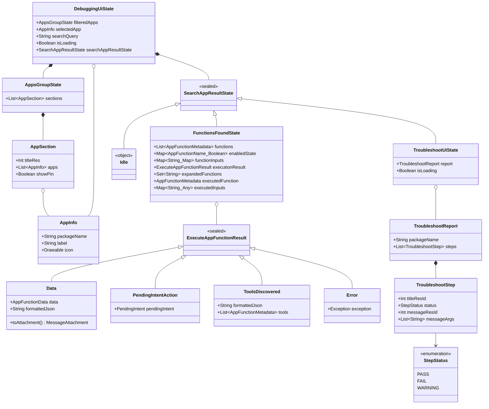
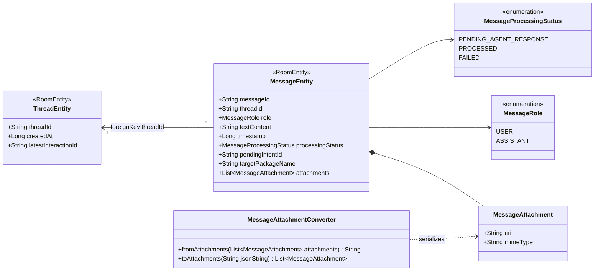
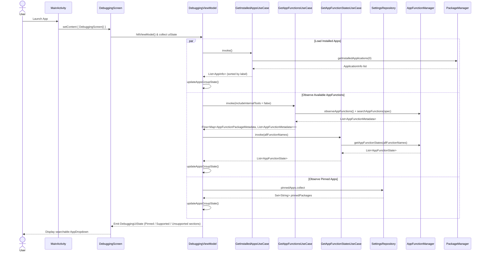
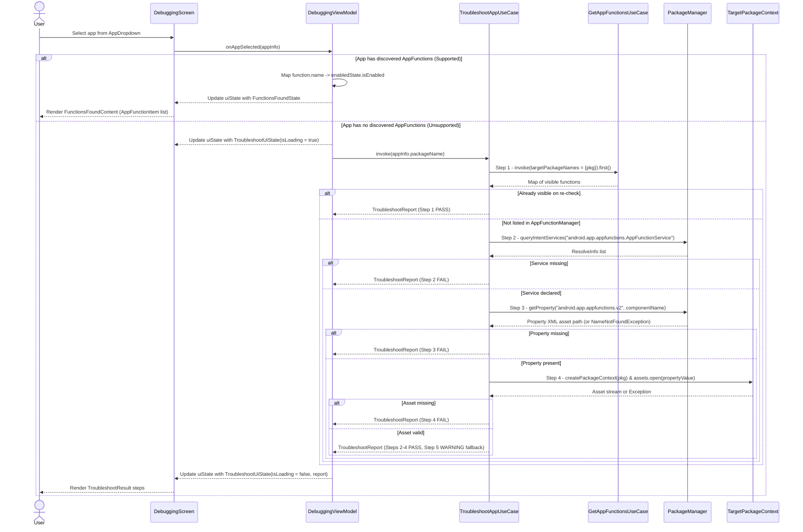
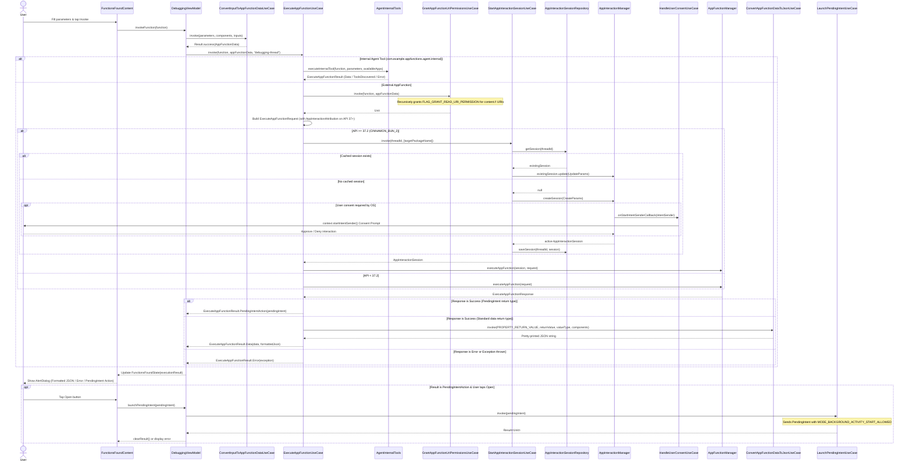

# AppFuncEx (`com.peyo.apfex`) — UML Class & Sequence Diagrams

> [!NOTE]
> **Architecture Overview**: `AppFuncEx` follows Android Clean Architecture + MVVM with Hilt dependency injection:
> - **UI Layer** (`ui.screens.debugging`): Jetpack Compose screens and [DebuggingViewModel.kt](file:///home/hdyoon/ex/rtlmex/src/com/peyo/apfex/ui/screens/debugging/DebuggingViewModel.kt) managing unidirectional `StateFlow<DebuggingUiState>`.
> - **Domain Layer** (`domain.*`): Focused use cases for querying/executing Android `AppFunctions`, managing API 37.2+ `AppInteractionSession`s & user consent, launching `PendingIntent`s, and troubleshooting target apps.
> - **Data Layer** (`data.*`): Jetpack DataStore settings, in-memory `AppInteractionSession` caching, internal agent tools (location, geocoding, Gemini image generation, progressive tool discovery), and Room entities.

---

## 1. UML Class Diagrams

### 1.1 `DebuggingViewModel` & Direct Collaborators (UI Entry & Injected Dependencies)

Focused view of [DebuggingViewModel.kt](file:///home/hdyoon/ex/rtlmex/src/com/peyo/apfex/ui/screens/debugging/DebuggingViewModel.kt), the UI Composables in [DebuggingScreen.kt](file:///home/hdyoon/ex/rtlmex/src/com/peyo/apfex/ui/screens/debugging/DebuggingScreen.kt) / [FunctionsFoundContent.kt](file:///home/hdyoon/ex/rtlmex/src/com/peyo/apfex/ui/screens/debugging/FunctionsFoundContent.kt) / [TroubleshootBottomSheet.kt](file:///home/hdyoon/ex/rtlmex/src/com/peyo/apfex/ui/screens/debugging/TroubleshootBottomSheet.kt) that observe and invoke it, and the exact Use Cases and Repository it directly accesses.

```mermaid
classDiagram
    direction TB

    class MainActivity {
        <<AndroidEntryPoint>>
        +onCreate(Bundle savedInstanceState) void
    }

    class DebuggingScreen {
        <<Composable>>
        +DebuggingScreen(DebuggingViewModel viewModel) void
        +DebuggingScreenContent(DebuggingUiState uiState) void
        +AppDropdown(AppsGroupState appGroups) void
    }

    class FunctionsFoundContent {
        <<Composable>>
        +FunctionsFoundContent(FunctionsFoundState state) void
        +AppFunctionItem(AppFunctionMetadata function) void
        +AppFunctionDataTypeInput(AppFunctionDataTypeMetadata dataType) void
    }

    class TroubleshootResult {
        <<Composable>>
        +TroubleshootResult(TroubleshootUiState state) void
    }

    class DebuggingViewModel {
        <<HiltViewModel>>
        -MutableStateFlow~DebuggingUiState~ _uiState
        +StateFlow~DebuggingUiState~ uiState
        -List~AppInfo~ allInstalledApps
        -Set~String~ pinnedPackages
        -Map allAppFunctions
        -Map allAppFunctionStates
        +onAppSelected(AppInfo appInfo) void
        +onClearSelectedApp() void
        +onSearchQueryChanged(String query) void
        +onFunctionInputsChange(String functionId, Map inputs) void
        +onFunctionExpandedChange(String functionId, Boolean expanded) void
        +invokeFunction(AppFunctionMetadata function) void
        +clearResult() void
        +launchPendingIntent(PendingIntent pendingIntent) void
        +onTogglePin(AppInfo appInfo) void
        -observePinnedApps() void
        -loadAppFunctions() void
        -loadInstalledApps() void
        -runTroubleshooting(String packageName) void
    }

    class DebuggingUiState {
        +AppsGroupState filteredApps
        +AppInfo selectedApp
        +String searchQuery
        +Boolean isLoading
        +SearchAppResultState searchAppResultState
    }

    class GetInstalledAppsUseCase {
        +invoke() List~AppInfo~
    }

    class GetAppFunctionsUseCase {
        +invoke(GetAppFunctionsParams params) Flow~AppFunctionMap~
    }

    class GetAppFunctionStatesUseCase {
        +invoke(List~AppFunctionName~ functionNames) List~AppFunctionState~
    }

    class ConvertInputToAppFunctionDataUseCase {
        +invoke(List parameters, AppFunctionComponentsMetadata components, Map inputs) Result~AppFunctionData~
    }

    class ExecuteAppFunctionUseCase {
        +invoke(AppFunctionMetadata function, AppFunctionData parameters, String threadId) ExecuteAppFunctionResult
    }

    class TroubleshootAppUseCase {
        +invoke(String packageName) TroubleshootReport
    }

    class LaunchPendingIntentUseCase {
        +invoke(PendingIntent pendingIntent) Result~Unit~
    }

    class SettingsRepository {
        <<interface>>
        +Flow~Set~ pinnedApps
        +setAppPinned(String packageName, Boolean pinned) void
    }

    %% UI to ViewModel
    MainActivity --> DebuggingScreen : renders
    DebuggingScreen --> FunctionsFoundContent : renders when FunctionsFoundState
    DebuggingScreen --> TroubleshootResult : renders when TroubleshootUiState
    DebuggingScreen --> DebuggingViewModel : observes uiState & dispatches events

    %% ViewModel State & Direct Accesses
    DebuggingViewModel *-- DebuggingUiState : exposes via StateFlow
    DebuggingViewModel --> GetInstalledAppsUseCase : loads installed apps
    DebuggingViewModel --> GetAppFunctionsUseCase : observes functions
    DebuggingViewModel --> GetAppFunctionStatesUseCase : queries enabled states
    DebuggingViewModel --> ConvertInputToAppFunctionDataUseCase : converts UI inputs
    DebuggingViewModel --> ExecuteAppFunctionUseCase : invokes AppFunction
    DebuggingViewModel --> TroubleshootAppUseCase : diagnoses unsupported app
    DebuggingViewModel --> LaunchPendingIntentUseCase : opens PendingIntent result
    DebuggingViewModel --> SettingsRepository : observes & updates pinnedApps
```

---

### 1.2 Domain, Data & DI Layer Class Diagram

Shows how Domain Use Cases collaborate with AndroidX `AppFunctionManager`, API 37.2+ `AppInteractionSession` management, internal agent tools, repositories, and Hilt DI modules ([ExecuteAppFunctionUseCase.kt](file:///home/hdyoon/ex/rtlmex/src/com/peyo/apfex/domain/appfunction/ExecuteAppFunctionUseCase.kt), [GetAppFunctionsUseCase.kt](file:///home/hdyoon/ex/rtlmex/src/com/peyo/apfex/domain/appfunction/GetAppFunctionsUseCase.kt), [StartAppInteractionSessionUseCase.kt](file:///home/hdyoon/ex/rtlmex/src/com/peyo/apfex/domain/appinteraction/StartAppInteractionSessionUseCase.kt), [AgentInternalTools.kt](file:///home/hdyoon/ex/rtlmex/src/com/peyo/apfex/data/AgentInternalTools.kt), [AppFunctionModule.kt](file:///home/hdyoon/ex/rtlmex/src/com/peyo/apfex/di/AppFunctionModule.kt), [DataModule.kt](file:///home/hdyoon/ex/rtlmex/src/com/peyo/apfex/di/DataModule.kt)).

```mermaid
classDiagram
    direction TB

    class ExecuteAppFunctionUseCase {
        +invoke(AppFunctionMetadata function, AppFunctionData parameters, String threadId) ExecuteAppFunctionResult
    }

    class GetAppFunctionsUseCase {
        +invoke(GetAppFunctionsParams params) Flow~AppFunctionMap~
    }

    class GetAppFunctionStatesUseCase {
        +invoke(List~AppFunctionName~ functionNames) List~AppFunctionState~
    }

    class TroubleshootAppUseCase {
        +invoke(String packageName) TroubleshootReport
    }

    class GrantAppFunctionUriPermissionsUseCase {
        +invoke(AppFunctionMetadata function, AppFunctionData parameters) void
    }

    class ConvertAppFunctionDataToJsonUseCase {
        +invoke(String name, AppFunctionData data, AppFunctionDataTypeMetadata dataType, AppFunctionComponentsMetadata components) String
    }

    class StartAppInteractionSessionUseCase {
        +invoke(String threadId, List~String~ targetPackages) AppInteractionSession
    }

    class HandleUserConsentUseCase {
        +invoke(IntentSender intentSender) void
    }

    class AppFunctionExceptionFormatter {
        <<object>>
        +format(AppFunctionException exception, String functionId) String
        +getAppFunctionException(Throwable throwable) AppFunctionException
    }

    class SettingsRepository {
        <<interface>>
        +Flow~String~ geminiApiKey
        +Flow~Boolean~ progressiveToolDisclosure
        +Flow~Set~ pinnedApps
        +Flow~Set~ disconnectedApps
        +setGeminiApiKey(String apiKey) void
        +setProgressiveToolDisclosure(Boolean enabled) void
        +setAppPinned(String packageName, Boolean pinned) void
        +setAppConnected(String packageName, Boolean connected) void
    }

    class DataStoreSettingsRepository {
        -DataStore~Preferences~ dataStore
    }

    class AppInteractionSessionRepository {
        <<interface>>
        +saveSession(String threadId, AppInteractionSession session) void
        +getSession(String threadId) AppInteractionSession
        +invalidateSession(String threadId) void
    }

    class InMemoryAppInteractionSessionRepository {
        -ConcurrentHashMap sessionMap
        -LifecycleListener lifecycleListener
    }

    class AgentInternalTools {
        +geocodeAddress(String address) LatLng
        +getCurrentLocation() LatLng
        +generateImage(String prompt, String aspectRatio) GeneratedImageResult
        +getInternalToolsMetadata() List~Pair~
        +buildToolDiscoveryTools(Map apps) List~AppFunctionMetadata~
        +executeInternalTool(AppFunctionMetadata function, AppFunctionData parameters, Map availableApps) ExecuteAppFunctionResult
    }

    class ToolDiscoveryTools {
        +buildTools(Map apps) List~AppFunctionMetadata~
        +execute(AppFunctionMetadata function, AppFunctionData parameters, Map apps) ExecuteAppFunctionResult
    }

    class AppFunctionModule {
        <<HiltModule>>
        +provideAppFunctionManager(Context context) AppFunctionManager
    }

    class DataModule {
        <<HiltModule>>
        +bindSettingsRepository(DataStoreSettingsRepository impl) SettingsRepository
        +bindAppInteractionSessionRepository(InMemoryAppInteractionSessionRepository impl) AppInteractionSessionRepository
        +provideDataStore(Context context) DataStore~Preferences~
    }

    class AppFunctionManager {
        <<AndroidX>>
    }

    %% Domain Use Case Collaborations
    TroubleshootAppUseCase --> GetAppFunctionsUseCase

    GetAppFunctionsUseCase --> AppFunctionManager
    GetAppFunctionsUseCase --> GetAppFunctionStatesUseCase
    GetAppFunctionsUseCase --> SettingsRepository
    GetAppFunctionsUseCase --> AgentInternalTools

    GetAppFunctionStatesUseCase --> AppFunctionManager

    ExecuteAppFunctionUseCase --> AppFunctionManager
    ExecuteAppFunctionUseCase --> ConvertAppFunctionDataToJsonUseCase
    ExecuteAppFunctionUseCase --> AgentInternalTools
    ExecuteAppFunctionUseCase --> GrantAppFunctionUriPermissionsUseCase
    ExecuteAppFunctionUseCase --> GetAppFunctionsUseCase
    ExecuteAppFunctionUseCase --> StartAppInteractionSessionUseCase : Lazy

    StartAppInteractionSessionUseCase --> AppInteractionSessionRepository
    StartAppInteractionSessionUseCase --> HandleUserConsentUseCase

    %% Data Implementations & DI
    SettingsRepository <|.. DataStoreSettingsRepository
    AppInteractionSessionRepository <|.. InMemoryAppInteractionSessionRepository
    AgentInternalTools --> ToolDiscoveryTools
    AppFunctionModule ..> AppFunctionManager : provides
    DataModule ..> DataStoreSettingsRepository : binds
    DataModule ..> InMemoryAppInteractionSessionRepository : binds
```

---

### 1.3 UI State & Domain Result Models

Defined in [DebuggingUiState.kt](file:///home/hdyoon/ex/rtlmex/src/com/peyo/apfex/ui/screens/debugging/DebuggingUiState.kt), [ExecuteAppFunctionUseCase.kt](file:///home/hdyoon/ex/rtlmex/src/com/peyo/apfex/domain/appfunction/ExecuteAppFunctionUseCase.kt#L175-L221), [AppInfo.kt](file:///home/hdyoon/ex/rtlmex/src/com/peyo/apfex/domain/appfunction/AppInfo.kt), and [TroubleshootReport.kt](file:///home/hdyoon/ex/rtlmex/src/com/peyo/apfex/domain/troubleshoot/TroubleshootReport.kt).

---

### 1.4 Room Database Entities

Defined in [ThreadEntity.kt](file:///home/hdyoon/ex/rtlmex/src/com/peyo/apfex/data.db.entities/ThreadEntity.kt) and [MessageEntity.kt](file:///home/hdyoon/ex/rtlmex/src/com/peyo/apfex/data.db.entities/MessageEntity.kt).

---

## 2. UML Sequence Diagrams

### 2.1 Initialization & Reactive App Discovery

Triggered when `MainActivity` mounts `DebuggingScreen` and instantiates [DebuggingViewModel.kt](file:///home/hdyoon/ex/rtlmex/src/com/peyo/apfex/ui/screens/debugging/DebuggingViewModel.kt#L79-L121). Three concurrent coroutines load installed packages, observe `AppFunctionManager` metadata + states, and observe pinned apps from DataStore to build grouped dropdown sections (`Pinned`, `Supported`, `Unsupported`).

---

### 2.2 App Selection & Automated Troubleshooting Flow

When a user selects an app in [DebuggingScreen.kt](file:///home/hdyoon/ex/rtlmex/src/com/peyo/apfex/ui/screens/debugging/DebuggingScreen.kt#L333-L337), [DebuggingViewModel.onAppSelected](file:///home/hdyoon/ex/rtlmex/src/com/peyo/apfex/ui/screens/debugging/DebuggingViewModel.kt#L124-L152) either populates the discovered functions list or runs the 5-step diagnostic pipeline in [TroubleshootAppUseCase.kt](file:///home/hdyoon/ex/rtlmex/src/com/peyo/apfex/domain/troubleshoot/TroubleshootAppUseCase.kt).

---

### 2.3 AppFunction Execution, Session Consent & PendingIntent Launch

Covers parameter input conversion ([ConvertInputToAppFunctionDataUseCase.kt](file:///home/hdyoon/ex/rtlmex/src/com/peyo/apfex/domain/appfunction/ConvertInputToAppFunctionDataUseCase.kt)), URI permission grants ([GrantAppFunctionUriPermissionsUseCase.kt](file:///home/hdyoon/ex/rtlmex/src/com/peyo/apfex/domain/appfunction/GrantAppFunctionUriPermissionsUseCase.kt)), API 37.2+ `AppInteractionSession` acquisition and consent UI ([StartAppInteractionSessionUseCase.kt](file:///home/hdyoon/ex/rtlmex/src/com/peyo/apfex/domain/appinteraction/StartAppInteractionSessionUseCase.kt)), execution ([ExecuteAppFunctionUseCase.kt](file:///home/hdyoon/ex/rtlmex/src/com/peyo/apfex/domain/appfunction/ExecuteAppFunctionUseCase.kt)), and optional `PendingIntent` follow-up ([LaunchPendingIntentUseCase.kt](file:///home/hdyoon/ex/rtlmex/src/com/peyo/apfex/domain/pendingintent/LaunchPendingIntentUseCase.kt)).

