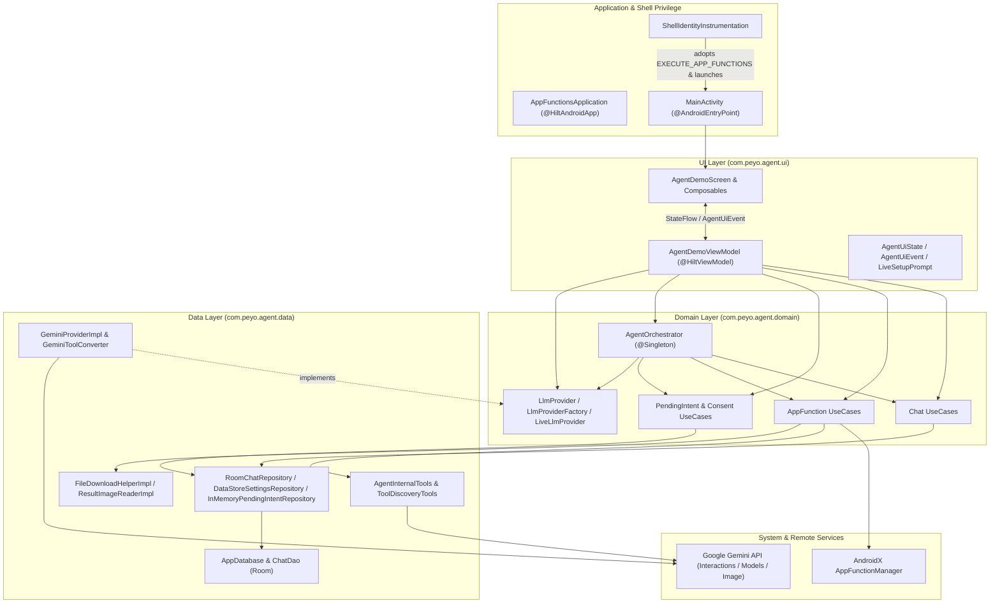
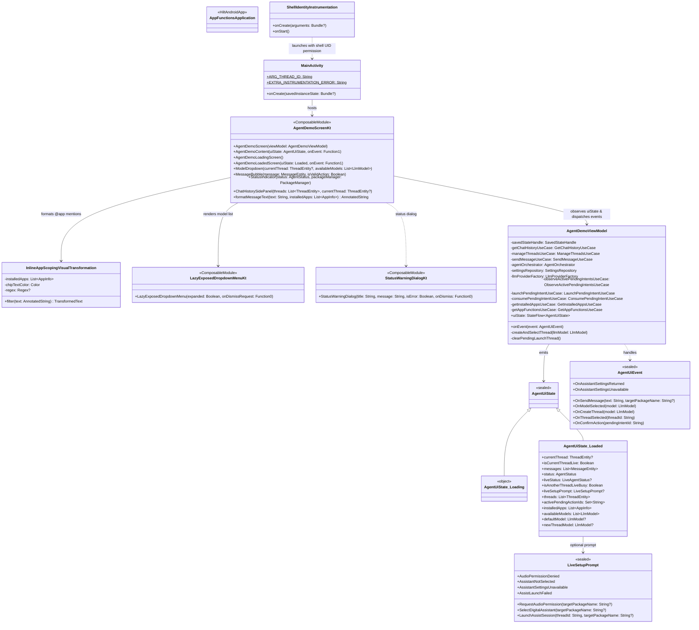
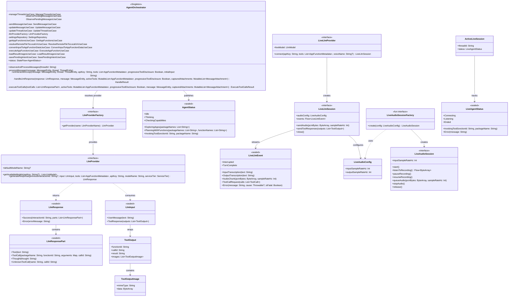
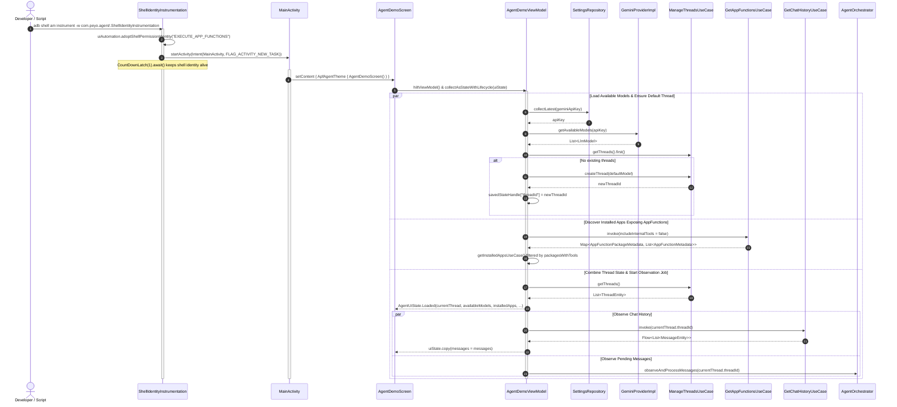
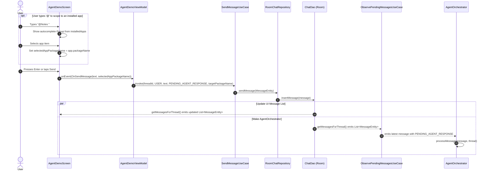
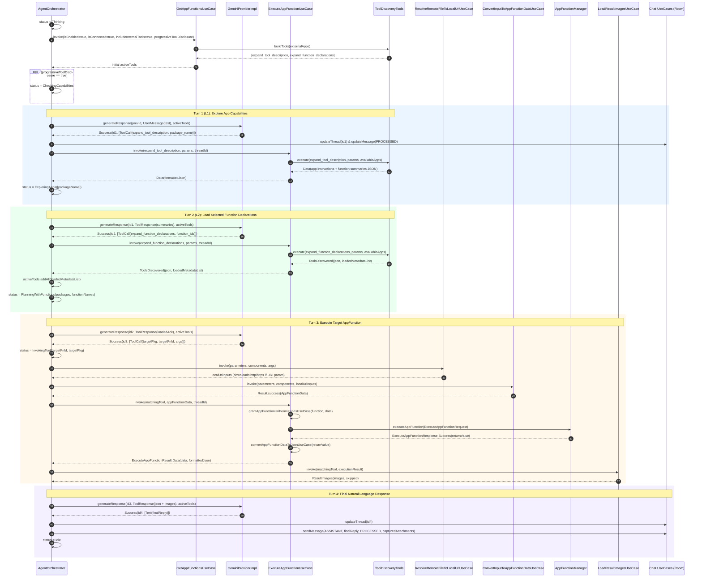
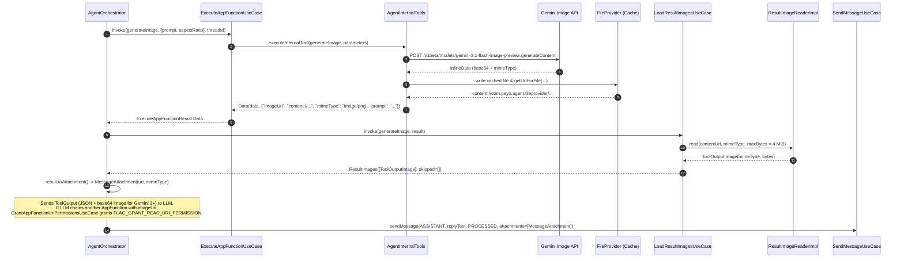
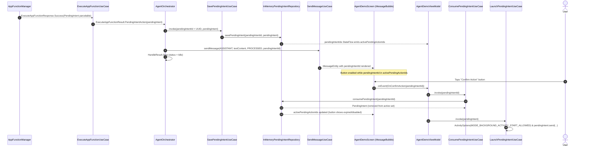

# AppFunction Testing Agent (`com.peyo.agent`) — UML Class & Sequence Diagrams

This document provides comprehensive UML **Class Diagrams** and **Sequence Diagrams** for the Android AppFunction Testing Agent (`com.peyo.agent`).

---

## Architecture Overview

The application follows a clean, reactive **UI → Domain → Data** architecture wired with **Dagger Hilt**, **Jetpack Compose**, **Room**, **DataStore**, **Ktor**, and **AndroidX AppFunctions**.

---

## 1. UML Class Diagrams

### 1.1 Application Entry Points & UI Presentation Layer

Covers application bootstrap, shell permission instrumentation, Compose UI components, state holders, and `AgentDemoViewModel`.

---

### 1.2 Core Domain: Agent Orchestration, LLM Contracts & Live Session Abstractions

Covers `AgentOrchestrator`, status state machines, text/multimodal LLM provider abstractions, and realtime bidirectional voice (`LiveLlmProvider` / `LiveAudioSession`) contracts.

---

### 1.3 Domain Use Cases (Chat, AppFunction, PendingIntent & User Consent)

Covers all domain use cases mediating between `AgentDemoViewModel` / `AgentOrchestrator` and the data repositories / Android `AppFunctionManager`.

```mermaid
classDiagram
    direction TB

    class GetChatHistoryUseCase {
        -chatRepository: ChatRepository
        +invoke(threadId: String) Flow~List_MessageEntity~
    }

    class ManageThreadsUseCase {
        -chatRepository: ChatRepository
        +getThreads() Flow~List_ThreadEntity~
        +getThread(threadId: String) Flow~ThreadEntity~
        +createThread(llmModel: LlmModel) String
        +updateThreadModel(threadId: String, llmModel: LlmModel)
        +deleteThread(threadId: String)
    }

    class ObservePendingMessagesUseCase {
        -chatRepository: ChatRepository
        +invoke(threadId: String) Flow~MessageEntity~
    }

    class SendMessageUseCase {
        -chatRepository: ChatRepository
        +invoke(threadId: String, role: MessageRole, textContent: String, processingStatus: MessageProcessingStatus, pendingIntentId: String?, targetPackageName: String?, attachments: List~MessageAttachment~)
    }

    class UpdateMessageUseCase {
        -chatRepository: ChatRepository
        +invoke(messageId: String, params: UpdateMessageParams)
    }

    class UpdateThreadUseCase {
        -chatRepository: ChatRepository
        +invoke(threadId: String, params: UpdateThreadParams)
    }

    class GetAppFunctionsUseCase {
        -appFunctionManager: AppFunctionManager?
        -getAppFunctionStatesUseCase: GetAppFunctionStatesUseCase
        -settingsRepository: SettingsRepository
        -agentInternalTools: AgentInternalTools
        +invoke(params: GetAppFunctionsParams) Flow~AppFunctionsMap~
    }

    class GetAppFunctionsParams {
        +targetPackageNames: Set~String~?
        +isEnabled: Boolean?
        +isConnected: Boolean?
        +includeInternalTools: Boolean
        +progressiveToolDisclosure: Boolean
    }

    class GetAppFunctionStatesUseCase {
        -appFunctionManager: AppFunctionManager?
        +invoke(functionNames: List~AppFunctionName~) List~AppFunctionState~
    }

    class GetInstalledAppsUseCase {
        -context: Context
        +invoke() List~AppInfo~
    }

    class AppInfo {
        +packageName: String
        +label: String
        +icon: Drawable?
    }

    class ExecuteAppFunctionUseCase {
        -appFunctionManager: AppFunctionManager?
        -convertAppFunctionDataToJsonUseCase: ConvertAppFunctionDataToJsonUseCase
        -agentInternalTools: AgentInternalTools
        -grantAppFunctionUriPermissionsUseCase: GrantAppFunctionUriPermissionsUseCase
        -getAppFunctionsUseCase: GetAppFunctionsUseCase
        +invoke(function: AppFunctionMetadata, parameters: AppFunctionData, threadId: String) ExecuteAppFunctionResult
    }

    class ExecuteAppFunctionResult {
        <<sealed>>
        +Data(data: AppFunctionData, formattedJson: String)
        +PendingIntentAction(pendingIntent: PendingIntent)
        +ToolsDiscovered(formattedJson: String, tools: List~AppFunctionMetadata~)
        +Error(exception: Exception)
    }

    class ConvertInputToAppFunctionDataUseCase {
        +invoke(parameters: List~AppFunctionParameterMetadata~, components: AppFunctionComponentsMetadata, inputs: Map) Result~AppFunctionData~
    }

    class ConvertAppFunctionDataToJsonUseCase {
        +invoke(name: String, data: AppFunctionData, dataType: AppFunctionDataTypeMetadata, components: AppFunctionComponentsMetadata) String
    }

    class ResolveRemoteFileToLocalUriUseCase {
        -fileDownloadHelper: FileDownloadHelper
        +invoke(parameters: List~AppFunctionParameterMetadata~, components: AppFunctionComponentsMetadata, inputs: Map) Map
    }

    class GrantAppFunctionUriPermissionsUseCase {
        -context: Context
        +invoke(function: AppFunctionMetadata, parameters: AppFunctionData)
    }

    class LoadResultImagesUseCase {
        -resultImageReader: ResultImageReader
        +invoke(function: AppFunctionMetadata, result: ExecuteAppFunctionResult_Data) ResultImages
    }

    class ResultImages {
        +images: List~ToolOutputImage~
        +skipped: List~SkippedResultImage~
    }

    class AppFunctionExceptionFormatter {
        <<object>>
        +format(exception: AppFunctionException, functionId: String?) String
        +getAppFunctionException(throwable: Throwable?) AppFunctionException?
    }

    class ToolConverter~T~ {
        <<interface>>
        +convert(tool: AppFunctionMetadata) T
        +getToolName(tool: AppFunctionMetadata) String
    }

    class SavePendingIntentUseCase {
        -pendingIntentRepository: PendingIntentRepository
        +invoke(pendingIntentId: String, pendingIntent: PendingIntent)
    }

    class ConsumePendingIntentUseCase {
        -pendingIntentRepository: PendingIntentRepository
        +invoke(pendingIntentId: String) PendingIntent?
    }

    class ObserveActivePendingIntentsUseCase {
        -pendingIntentRepository: PendingIntentRepository
        +invoke() StateFlow~Set_String~
    }

    class LaunchPendingIntentUseCase {
        -context: Context
        +invoke(pendingIntent: PendingIntent) Result~Unit~
    }

    class HandleUserConsentUseCase {
        <<Singleton>>
        -context: Context
        +invoke(intentSender: IntentSender)
    }

    GetAppFunctionsUseCase ..> GetAppFunctionsParams : uses
    GetAppFunctionsUseCase --> GetAppFunctionStatesUseCase : checks enabled state
    GetInstalledAppsUseCase ..> AppInfo : produces
    ExecuteAppFunctionUseCase --> GrantAppFunctionUriPermissionsUseCase : grants content URIs
    ExecuteAppFunctionUseCase --> ConvertAppFunctionDataToJsonUseCase : serializes output
    ExecuteAppFunctionUseCase --> GetAppFunctionsUseCase : queries apps for discovery
    ExecuteAppFunctionUseCase ..> ExecuteAppFunctionResult : returns
    LoadResultImagesUseCase ..> ResultImages : returns
```

---

### 1.4 Data Layer, Internal Tools, Persistence (Room & DataStore) & Hilt DI

Covers repository interfaces and implementations, Gemini HTTP client integration, built-in and progressive discovery tools, Room database schema, and Hilt modules.

```mermaid
classDiagram
    direction TB

    class DataModule {
        <<HiltModule>>
        +bindSettingsRepository(impl: DataStoreSettingsRepository) SettingsRepository
        +bindChatRepository(impl: RoomChatRepository) ChatRepository
        +bindPendingIntentRepository(impl: InMemoryPendingIntentRepository) PendingIntentRepository
        +bindLlmProviderFactory(impl: LlmProviderFactoryImpl) LlmProviderFactory
        +bindFileDownloadHelper(impl: FileDownloadHelperImpl) FileDownloadHelper
        +bindResultImageReader(impl: ResultImageReaderImpl) ResultImageReader
        +provideDataStore(context: Context) DataStore$
        +provideAppDatabase(context: Context) AppDatabase$
        +provideChatDao(db: AppDatabase) ChatDao$
        +provideHttpClient() HttpClient$
    }

    class AppFunctionModule {
        <<HiltModule>>
        +provideAppFunctionManager(context: Context) AppFunctionManager?$
    }

    class ChatRepository {
        <<interface>>
        +getMessagesForThread(threadId: String) Flow~List_MessageEntity~
        +sendMessage(message: MessageEntity)
        +updateMessageStatus(messageId: String, status: MessageProcessingStatus)
        +createThread(thread: ThreadEntity)
        +updateThreadModel(threadId: String, llmModel: LlmModel)
        +getThreads() Flow~List_ThreadEntity~
        +getThread(threadId: String) Flow~ThreadEntity~
        +deleteThread(threadId: String)
        +getLatestInteractionId(threadId: String) Flow~String~
        +updateLatestInteractionId(threadId: String, interactionId: String)
        +getThreadByInteractionId(interactionId: String) Flow~ThreadEntity~
    }

    class RoomChatRepository {
        <<Singleton>>
        -chatDao: ChatDao
    }

    class AppDatabase {
        <<RoomDatabase>>
        +chatDao() ChatDao
    }

    class ChatDao {
        <<Dao>>
        +getMessagesForThread(threadId: String) Flow~List_MessageEntity~
        +insertMessage(message: MessageEntity)
        +updateMessageStatus(messageId: String, status: MessageProcessingStatus)
        +insertThread(thread: ThreadEntity)
        +updateLatestInteractionId(threadId: String, interactionId: String)
        +updateThreadModel(threadId: String, llmModel: LlmModel)
        +getThreads() Flow~List_ThreadEntity~
        +getThread(threadId: String) Flow~ThreadEntity~
        +deleteThread(threadId: String)
    }

    class ThreadEntity {
        <<Entity>>
        +threadId: String
        +createdAt: Long
        +llmModel: LlmModel
        +latestInteractionId: String?
    }

    class MessageEntity {
        <<Entity>>
        +messageId: String
        +threadId: String
        +role: MessageRole
        +textContent: String
        +timestamp: Long
        +processingStatus: MessageProcessingStatus
        +pendingIntentId: String?
        +targetPackageName: String?
        +attachments: List~MessageAttachment~
    }

    class MessageAttachment {
        +uri: String
        +mimeType: String
    }

    class MessageRole {
        <<enumeration>>
        USER
        ASSISTANT
    }

    class MessageProcessingStatus {
        <<enumeration>>
        PENDING_AGENT_RESPONSE
        PROCESSED
        FAILED
    }

    class SettingsRepository {
        <<interface>>
        +geminiApiKey: Flow~String~
        +selectedProvider: Flow~LlmProviderName~
        +serviceTier: Flow~ServiceTier~
        +progressiveToolDisclosure: Flow~Boolean~
        +pinnedApps: Flow~Set_String~
        +disconnectedApps: Flow~Set_String~
        +getApiKey(provider: LlmProviderName) Flow~String~
        +setGeminiApiKey(apiKey: String)
        +setSelectedProvider(provider: LlmProviderName)
        +setServiceTier(tier: ServiceTier)
        +setProgressiveToolDisclosure(enabled: Boolean)
        +setAppPinned(packageName: String, pinned: Boolean)
        +setAppConnected(packageName: String, connected: Boolean)
    }

    class DataStoreSettingsRepository {
        -dataStore: DataStore~Preferences~
    }

    class LlmProviderName {
        <<enumeration>>
        GEMINI
        +displayName: String
    }

    class LlmModel {
        +providerName: LlmProviderName
        +modelName: String
    }

    class ServiceTier {
        <<enumeration>>
        STANDARD
        PRIORITY
        +apiValue: String?
    }

    class PendingIntentRepository {
        <<interface>>
        +pendingIntentIds: StateFlow~Set_String~
        +savePendingIntent(pendingIntentId: String, pendingIntent: PendingIntent)
        +consumePendingIntent(pendingIntentId: String) PendingIntent?
    }

    class InMemoryPendingIntentRepository {
        <<Singleton>>
        -actions: MutableMap~String_PendingIntent~
    }

    class LlmProviderFactoryImpl {
        <<Singleton>>
        -geminiProvider: GeminiProviderImpl
        +getProvider(name: LlmProviderName) LlmProvider
    }

    class GeminiProviderImpl {
        <<Singleton>>
        -httpClient: HttpClient
        -toolConverter: GeminiToolConverter
        +defaultModelName: String
        +getAvailableModels(apiKey: String?) List~LlmModel~
        +generateResponse(previousInteractionId: String?, input: LlmInput, tools: List~AppFunctionMetadata~, apiKey: String, modelName: String, serviceTier: ServiceTier) LlmResponse
    }

    class GeminiToolConverter {
        <<Singleton>>
        +convert(tool: AppFunctionMetadata) JsonObject
        +getToolName(tool: AppFunctionMetadata) String
    }

    class AgentInternalTools {
        <<Singleton>>
        -context: Context
        -settingsDataStore: DataStore~Preferences~
        -toolDiscoveryTools: ToolDiscoveryTools
        +geocodeAddress(address: String) LatLng?
        +getCurrentLocation() LatLng?
        +generateImage(prompt: String, aspectRatio: String?) GeneratedImageResult
        +getInternalToolsMetadata() List~Pair~
        +buildToolDiscoveryTools(apps: Map) List~AppFunctionMetadata~
        +executeInternalTool(function: AppFunctionMetadata, parameters: AppFunctionData, availableApps: Map) ExecuteAppFunctionResult
    }

    class ToolDiscoveryTools {
        <<Singleton>>
        -context: Context
        +buildTools(apps: Map) List~AppFunctionMetadata~
        +execute(function: AppFunctionMetadata, parameters: AppFunctionData, apps: Map) ExecuteAppFunctionResult
    }

    class FileDownloadHelper {
        <<interface>>
        +downloadToLocalUri(url: String) String
    }

    class FileDownloadHelperImpl {
        <<Singleton>>
        -context: Context
        +downloadToLocalUri(url: String) String
    }

    class ResultImageReader {
        <<interface>>
        +read(uri: Uri, mimeType: String?, maxBytes: Int) ToolOutputImage
    }

    class ResultImageReaderImpl {
        <<Singleton>>
        -context: Context
        +read(uri: Uri, mimeType: String?, maxBytes: Int) ToolOutputImage
    }

    ChatRepository <|.. RoomChatRepository
    RoomChatRepository --> ChatDao : delegates
    AppDatabase --> ChatDao : exposes
    ChatDao ..> ThreadEntity : manages
    ChatDao ..> MessageEntity : manages
    ThreadEntity *-- LlmModel
    LlmModel --> LlmProviderName
    MessageEntity "0..*" --> "1" ThreadEntity : FK threadId (CASCADE)
    MessageEntity *-- MessageAttachment
    MessageEntity --> MessageRole
    MessageEntity --> MessageProcessingStatus
    SettingsRepository <|.. DataStoreSettingsRepository
    SettingsRepository ..> ServiceTier
    PendingIntentRepository <|.. InMemoryPendingIntentRepository
    LlmProviderFactoryImpl --> GeminiProviderImpl
    GeminiProviderImpl --> GeminiToolConverter : converts schemas
    AgentInternalTools --> ToolDiscoveryTools : delegates L1/L2 discovery
    FileDownloadHelper <|.. FileDownloadHelperImpl
    ResultImageReader <|.. ResultImageReaderImpl
    DataModule ..> RoomChatRepository : binds
    DataModule ..> DataStoreSettingsRepository : binds
    DataModule ..> InMemoryPendingIntentRepository : binds
    DataModule ..> LlmProviderFactoryImpl : binds
```

---

## 2. UML Sequence Diagrams

### 2.1 Elevated Shell Launch & ViewModel Initialization

Illustrates how `./startAppFunctionTestingAgent` launches `ShellIdentityInstrumentation` to adopt `android.permission.EXECUTE_APP_FUNCTIONS`, starts `MainActivity`, and initializes `AgentDemoViewModel` streams.

---

### 2.2 User Message Submission & `@App` Mention Scoping

Illustrates how typing a prompt (optionally scoped to a specific app via `@AppLabel` autocomplete) persists a `PENDING_AGENT_RESPONSE` message in Room and reactively triggers both the UI chat list and `AgentOrchestrator`.

---

### 2.3 Multi-Turn Progressive Tool Disclosure & AppFunction Execution

Illustrates the full agent loop in `AgentOrchestrator`:
- **L0 (`CheckingCapabilities`)**: Declares internal tools plus `expand_tool_description` and `expand_function_declarations` (skipped when `targetPackageName != null`).
- **L1 (`ExploringApps`)**: Model inspects an app's instructions and function summaries.
- **L2 (`PlanningWithFunctions`)**: Model loads full function schemas dynamically into `activeTools` for the remainder of the turn.
- **Tool Execution (`InvokingTool`)**: Resolves remote `http(s)://` file URLs, builds `AppFunctionData`, grants `content://` read permissions, invokes `AppFunctionManager`, reads any returned images, and sends final assistant Markdown + attachments.

---

### 2.4 Internal Image Generation & Multimodal Result Attachment

Illustrates how `AgentInternalTools.generateImage` calls the Gemini image generation endpoint, caches the image via `FileProvider`, exposes the `content://` URI to both Gemini 3+ (`ToolOutputImage`) and the Compose chat UI (`MessageAttachment`), and allows chaining into downstream AppFunctions (with automatic URI read permission grant).

---

### 2.5 Dynamic `PendingIntent` Confirmation Flow

Illustrates how an AppFunction returning a `PendingIntent` pauses automatic execution, caches the `PendingIntent` transiently in memory, renders an interactive confirmation button in `MessageBubble`, and launches the `PendingIntent` once confirmed by the user.

